<div align="center">

# RollPay

### It checks the pay before the paycheck.

**An AI payroll agent for small service companies.** RollPay syncs Jobber, QuickBooks and Gusto, runs 23 deterministic checks, puts Creao agents on everything a rule can't see, texts the right person one short question, and hands the owner a Gusto draft that's already right.

[**Live demo →**](https://payrollpilot.vercel.app/c/a) &nbsp;·&nbsp; [Manager inbox on your phone](https://payrollpilot.vercel.app/c/a/manager) &nbsp;·&nbsp; [Proof and numbers](docs/PROOF.md) &nbsp;·&nbsp; [Demo script](docs/DEMO.md)

     

<br/>

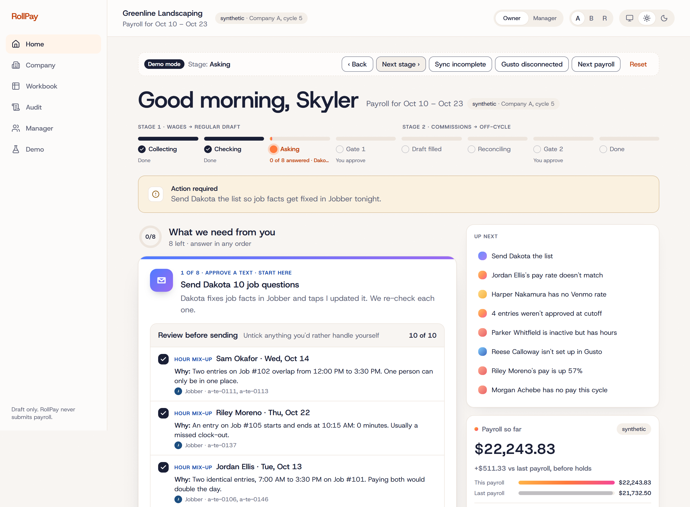

</div>

---

## Why

Payroll software does the math right. It assumes the inputs are right, and in service businesses they never are: a timer left running overnight, two overlapping entries, a crew member on Venmo with no rate, a rate that says $26 in Jobber and $25 in Gusto, a purchase with no job. Every other Friday the owner spends hours chasing those down by text before they dare press submit.

RollPay is the hire who does that chasing. It fills the seat of **the person who prepares and checks payroll**, and half the seat of **the job manager** who gets asked "whose hours are these?"

<div align="center">

| **23** | **3** | **3** | **35 / 46** | **0** |
|:---:|:---:|:---:|:---:|:---:|
| deterministic checks, every cycle | Creao agents: Auditor, Messenger, Analyst | systems synced and proven complete | real pay periods reproduced **to the cent** | pay amounts ever sent in a text |

</div>

## How it works

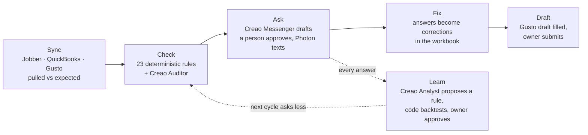

1. **Sync.** Every cycle RollPay pulls all three systems and records *pulled vs expected* for every object. A pull that doesn't add up blocks exactly what it covers, nothing more.
2. **Check.** A pure TypeScript engine runs 23 checks over hours, jobs, expenses, rates and pay. Then the Creao **Auditor** reads across everything the rules can't: fuzzy job matches, patterns across workers, entries that fit no job's dates.
3. **Ask.** Anything that needs a human becomes one short question, routed to the person who actually knows: the manager for job facts, the employee for their own hours, the owner for money. The Creao **Messenger** drafts it, a person approves it, and it goes out by iMessage.
4. **Fix.** Replies are read back automatically (numbered options, poll taps, free text). Each answer becomes a proposed correction in RollPay's own workbook. Jobber and Gusto are never edited.
5. **Learn.** The Creao **Analyst** turns answers and history into rules. Code backtests each one against what was actually paid; the owner approves it. On the same cycle-2 payroll, the items needing a person drop from 21 to 17 after one cycle of learning.
6. **Draft.** RollPay computes pay to the cent, fills the Gusto draft and stops. The owner submits.

## Deterministic where it counts, agentic where it helps

RollPay splits the work cleanly: **plain code owns the money, Creao agents own the judgment.** A check never guesses and an agent never pays anyone.

| | Deterministic engine (`packages/engine`) | Creao agents (`apps/web/convex/creao*.ts`) |
|---|---|---|
| **What it does** | 23 checks, Stage 1 and Stage 2 payroll math in integer cents, overtime, Venmo, commissions, message templates | **Auditor** matches orphan hours and purchases to jobs, raises vague cases no fixed rule could, writes the owner's morning brief. **Messenger** drafts questions for flags no template covers. **Analyst** learns the company's rules from past payrolls |
| **When it fires** | On exact conditions only. Same inputs, same flags, every time | After the checks, started by the controller through Creao's API trigger |
| **What it can change** | Pay, but only from approved inputs and rules | Nothing. Every output is a validated proposal waiting for a person |
| **What it sees** | Everything | Ids, dates, hours and job numbers. Never names, phone numbers, notes or pay |
| **Model** | none | Claude Opus 5.5 on Creao; Claude Haiku 5.5 reads replies in real time |

Each agent is a saved Creao agent built reproducibly from the repo (`apps/web/scripts/creao-agents.ts`). It works through RollPay's own tool API (`/agent/*` and `/mcp`), gets schema-checked on the way back in, and lands in the audit log with its run id. Agent confidence is a gate, not a vibe: a job match under 85% turns into a question automatically.

> Take the agents out and RollPay is a calculator. Without the Analyst there are no learned rules; without the Auditor, no fuzzy matches or morning brief; without the Messenger, no questions.

## Flagging: 23 checks, one decision each

Every flag carries its source records, a confidence (`rule: certain` or a percentage), a precedent if one exists, and exactly the buttons the decision needs. Only the disputed item is held; everyone else's pay keeps moving.

<p align="center">
  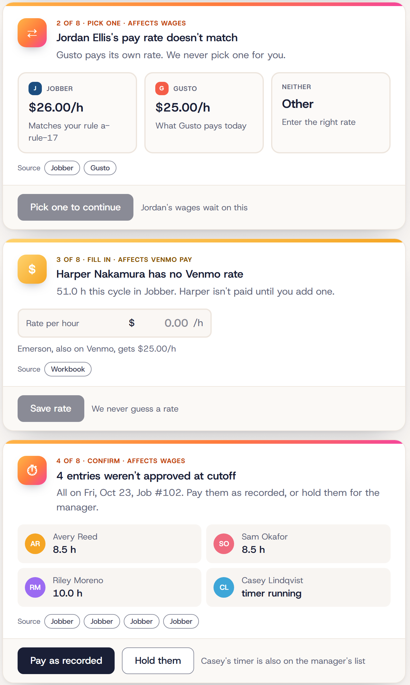
</p>

<details>
<summary><b>The full check catalogue</b></summary>

| Area | Checks |
|---|---|
| **Hours** | CHK-01 hours with no job · CHK-02 timer still running at cutoff · CHK-03 unusually long shift · CHK-04 overlapping entries · CHK-05 zero-minute or duplicate entry · CHK-06 not approved at cutoff |
| **People** | CHK-07 active worker with no hours · CHK-08 inactive worker with hours · CHK-09 not onboarded in Gusto · CHK-12 paid outside the Gusto sync (salary, Venmo, commission) |
| **Rates** | CHK-10 rate differs between Jobber and Gusto · CHK-11 Venmo contractor with no rate · CHK-18 labor costed at a stale rate |
| **Jobs and expenses** | CHK-13 job with a visit but no labor · CHK-14 purchase with no job · CHK-15 purchase counted twice across Jobber and QuickBooks · CHK-16 disposal run not linked to its job · CHK-17 expense category not decided |
| **Revenue and commission** | CHK-19 deposit counted as final payment · CHK-20 wrong salesperson on a quote · CHK-21 job margin below the company's threshold |
| **Safety net** | CHK-22 anyone's pay moved more than 25% vs their last 3 payrolls · CHK-23 a sync came back incomplete |
| **Agent** | Auditor-raised cases that fit no rule. These always become a question, never a block |

</details>

## Messaging the right person

The owner approves one batch; the manager gets one text and a link to a phone-first inbox with exactly what to fix in Jobber. Tap **I updated it** and RollPay re-checks that record right away. Texts carry dates, hours and job numbers, never names or pay. Anyone can reply STOP.

<table>
  <tr>
    <td width="58%" valign="top">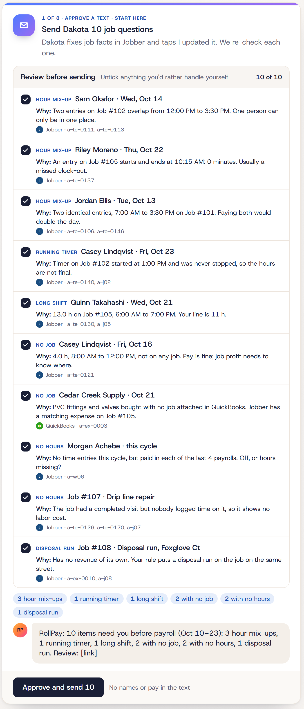</td>
    <td width="42%" valign="top">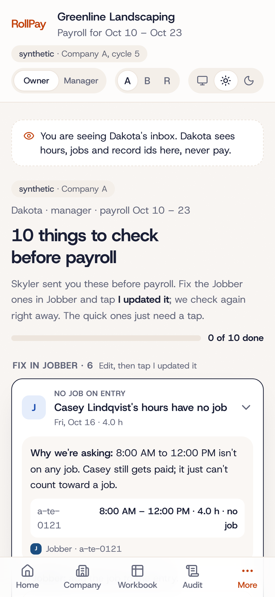</td>
  </tr>
  <tr>
    <td align="center"><sub>Owner: review the batch and the exact text, then approve</sub></td>
    <td align="center"><sub>Manager: one inbox, a reason for every ask, fix and tap</sub></td>
  </tr>
</table>

A courier process (Bun + Photon `spectrum-ts`) is the only thing that ever touches a phone number; the backend only sees a hash. Unanswered texts get a reminder on a timer, and polls let people answer with one tap.

## It learns your company

Onboarding reads your last four payrolls and the Analyst proposes the rules you already follow: overtime, Venmo rates, who answers what, which expense goes on which job. Each rule shows the cycles it was seen in and its backtest, and nothing is used until the owner approves it. The person who answered a question can never approve the rule it becomes.

<p align="center">
  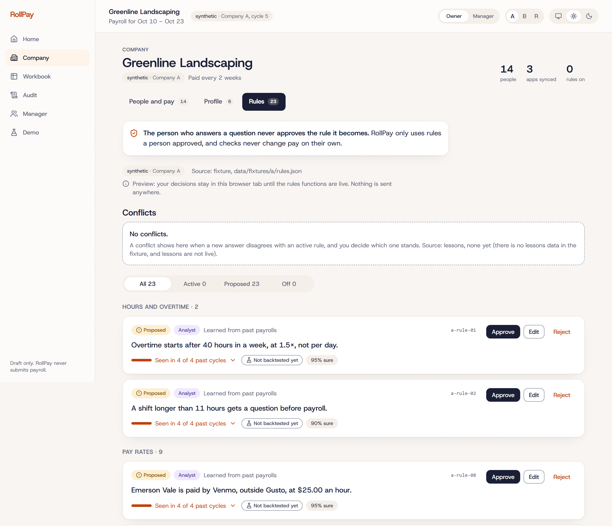
</p>

## Every number traces back

An append-only audit log records every pull, flag, agent run, message, answer, correction, rule and draft fill, with the actor (controller, Auditor, Messenger, Analyst, owner, manager) and a link to the source record. CI fails the build if anything tries to patch or delete an audit row.

<p align="center">
  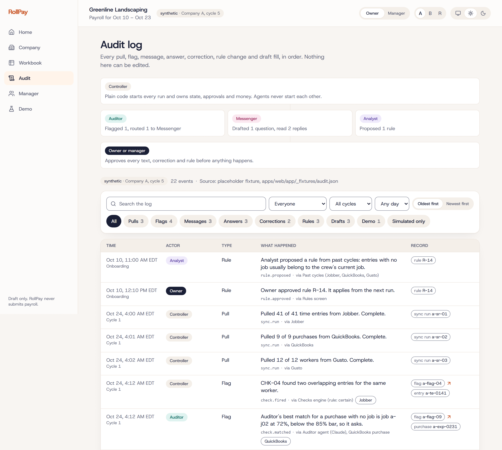
</p>

<details>
<summary><b>More screens</b></summary>

**Gate 1: review the draft before it's filled.** Labor vs revenue, pay per person against their usual, everything flagged inline.

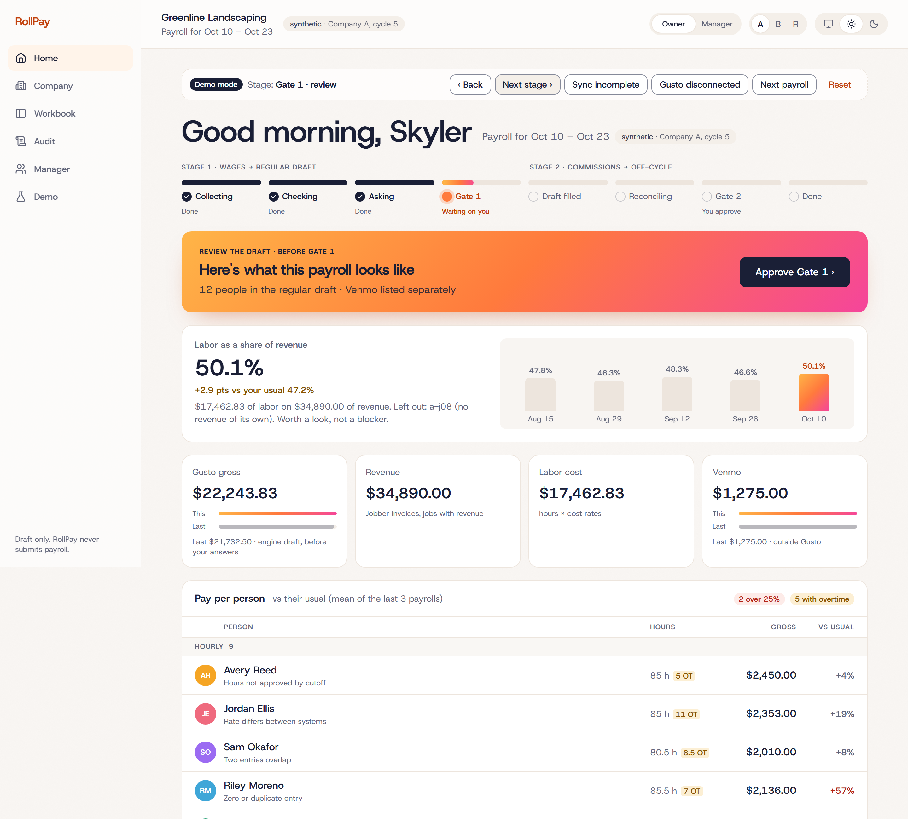

**Workbook.** Wages person by person; tap anyone to see the math.

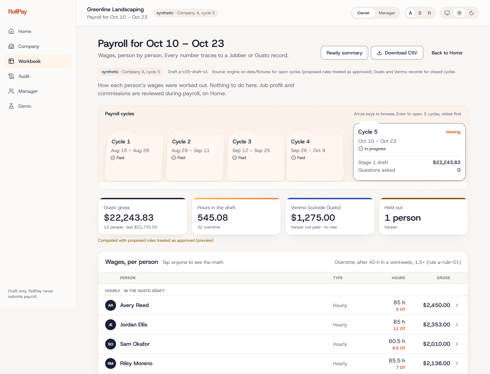

**People and pay.** Jobber, Gusto and your rules side by side, with pay history.

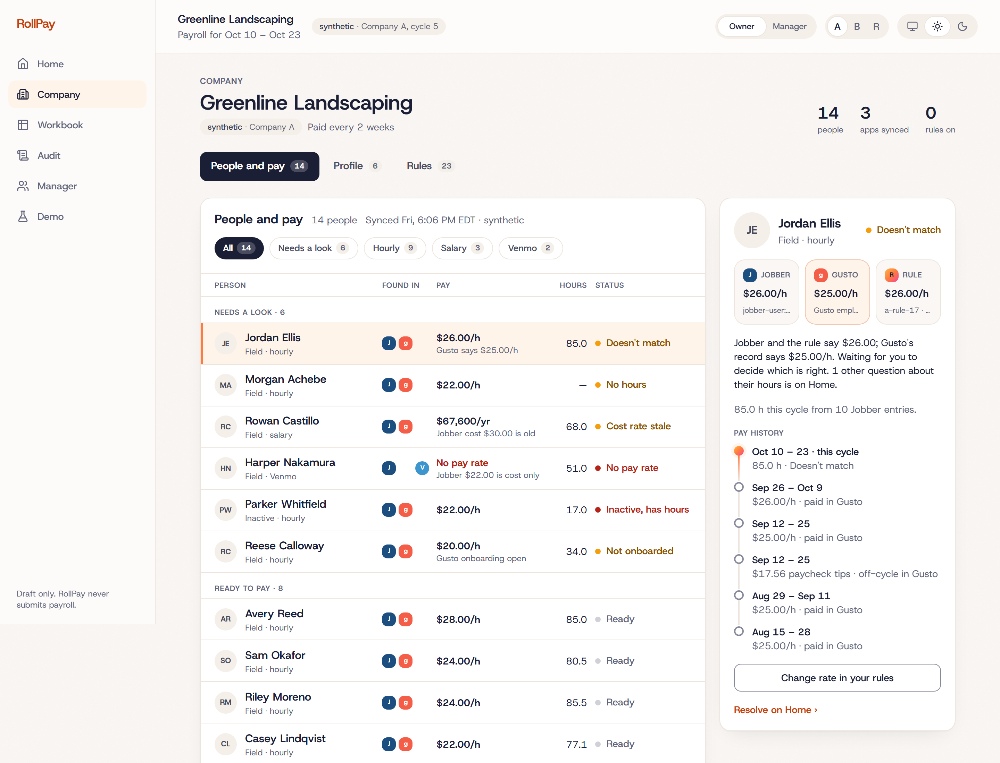

</details>

## It gets better every cycle, and we measure it

The same cycle-2 payroll, with its planted errors, run three times through the real checks engine. What still needs a person before the owner signs off:

| Rules in force | Need a person | Settled or rule-backed |
|---|:---:|:---:|
| None (day zero) | **28** | 0 |
| Onboarding's rules, learned from 4 past payrolls | **21** | 6 |
| Plus 3 rules learned from cycle 1's answers, each backtested 4 of 4 | **17** | 9 |

Every planted error the answer key says a learned rule should handle was handled. The engine catches **29 of 29** planted errors in cycle 1 and **30 of 31** in cycle 2, with **zero false alarms**. These evals run on every pull request: if a check stops catching an error or a learned rule stops settling one, CI fails. Method: [docs/PROOF.md §6](docs/PROOF.md#6-the-checks-engine-and-the-learning-curve-m1-m3).

## Proven on real payroll

| | Result | Data |
|---|---|---|
| Backtest on a real landscaping company | **35 of 46** worker pay periods match what was actually paid **to the cent**; **44 of 46 within $1** | 283 real timesheet entries, 188 payroll rows, 8 pay periods, anonymized at ingest |
| Planted-error detection | **29 of 29** caught in cycle 1, **30 of 31** in cycle 2, **0** false alarms | Company A, synthetic, answer key never shown to a model |
| Payroll math self-check | **120 of 120** worker-cycles to the cent, including California daily overtime | Company B, synthetic |
| QuickBooks sandbox read-back | **6 of 6** purchases matched | Company A, synthetic |
| Test suite | **700+** tests across 100+ files; Biome, typecheck and tests on every PR | `bun run test` |

The demo company, Greenline Landscaping, is a synthetic 12-person crew with planted errors and an answer key the model never sees. Every name on screen is fake. Method and sources: [docs/PROOF.md](docs/PROOF.md).

## Architecture

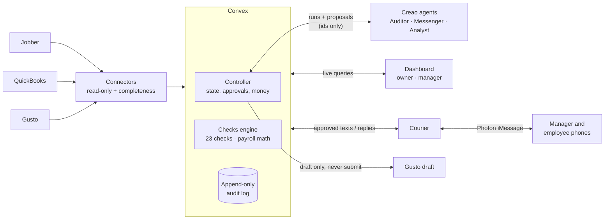

| Piece | Where | What |
|---|---|---|
| Dashboard | `apps/web` | Next.js 16, Tailwind, shadcn. Owner home, flag detail, manager inbox, onboarding, rules, workbook, audit. Manager views never include pay |
| Controller and backend | `apps/web/convex` | Convex database, scheduler, live queries and HTTP actions. Owns each cycle's state and every approval; starts Creao runs and validates what comes back |
| Creao agents | `apps/web/convex/creao.ts`, `creaoRuns.ts`, `agentApi.ts` | Tool API the agents call, run tracking, proposal intake |
| Engine | `packages/engine` | Pure TypeScript, no IO. Contract schemas (Zod), the 23 checks, Stage 1 and Stage 2 payroll math in integer cents, message templates |
| Connectors | `packages/connectors` | Jobber GraphQL, QuickBooks Online and Gusto readers plus export readers, each reporting pulled vs expected; anonymizer for real data |
| Courier | `apps/courier` | Bun + Photon `spectrum-ts`. Sends what Convex approved, relays replies, reminders and polls |
| Seed and eval | `seed/`, `eval/` | Synthetic companies with planted errors and answer keys; the metrics behind PROOF.md |

## Quick start

Needs Bun 1.3+ and Node 22+.

```bash
bun install
cp .env.example .env    # leave NEXT_PUBLIC_CONVEX_URL empty to run on the built-in fixtures
bun run dev             # http://localhost:3000/c/a
```

The dashboard runs fully on fixtures with no accounts. To run against Convex, `cd apps/web && bunx convex dev` in a second terminal and put the printed URL in `.env`. To text real phones, see [apps/courier/README.md](apps/courier/README.md); without credentials the courier prints texts to the terminal.

```bash
bun run check                # Biome + typecheck in every package
bun run test                 # every package's tests
cd eval && bun run metrics   # recompute eval/results.json
```

In the live demo, use **Next stage** to walk a payroll from collecting to done, switch **Owner / Manager** to see both sides, and **A / B / R** to switch companies.

## Built to be trusted

- **Read-only sources.** Corrections live in RollPay's workbook. Jobber, QuickBooks and Gusto are never edited.
- **Draft only.** There is no Gusto submit function anywhere in the codebase. The owner submits.
- **Humans approve everything.** Every text, correction and rule. An agent can't approve its own proposal, and whoever answered a question can't approve the rule it becomes.
- **Ids only to the model.** No names, phone numbers, notes, pay, SSNs or bank data ever reach an agent. Instructions found inside data are treated as data.
- **Never guesses.** No invented rates, no trimmed hours, no auto-corrections. Anything that needs judgment becomes a question.

## Built with

TypeScript · Bun · Next.js 16 · React 19 · Tailwind CSS · shadcn/ui · Convex · **Creao** · Claude Opus 5.5 and Haiku 5.5 · Photon Spectrum · Jobber API · Gusto API · QuickBooks Online API · Zod · Vitest · Playwright · Biome

<details>
<summary><b>Repo map and team docs</b></summary>

```
apps/web          dashboard (Next.js) + Convex backend, controller and Creao integration
apps/courier      texting worker (Photon)
packages/engine   checks, payroll math, schemas: pure, no IO
packages/connectors  Jobber, QuickBooks, Gusto readers + anonymizer
seed/             synthetic companies, planted errors, sandbox pushers
eval/             metrics M1–M6 behind docs/PROOF.md
data/fixtures/    Company A and B fixtures (synthetic)
docs/             proof, demo script, integrations, plans
specs/            product spec and every decision behind it
```

- [docs/PROOF.md](docs/PROOF.md): what was measured, how and when
- [docs/DEMO.md](docs/DEMO.md): demo script and shot list
- [docs/plans/creao-plan.md](docs/plans/creao-plan.md): how the Creao agents fit behind the controller
- [docs/plans/00-shared-context.md](docs/plans/00-shared-context.md): contracts, stack and the checks catalogue
- [specs/final.md](specs/final.md): the product spec; [specs/conflicts.md](specs/conflicts.md): every decision and why
- [docs/STATUS.md](docs/STATUS.md) and [docs/INTEGRATIONS.md](docs/INTEGRATIONS.md): build log and integration checks
- [AGENTS.md](AGENTS.md): rules for coding agents working in this repo

</details>

## Team

Built in 36 hours at Cal Hacks 13.0 by **Varnika** (product, messaging and demo), **Devaj** (agents and backend) and **Shanin** (data and payroll). One of us runs a service company and does this payroll every other Friday; RollPay is the hire we wanted.
