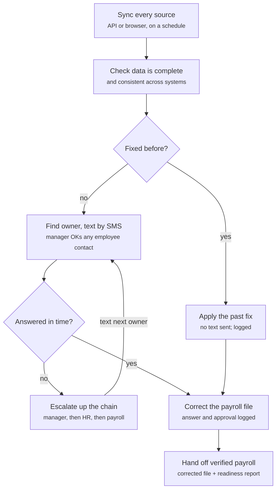

# Payroll Ops Agent — Product Spec

October 23, 2026 · Hackathon product spec (Hyphenate track)

## Overview

An autonomous agent that gets payroll right before it runs: it pulls data from every system that feeds payroll, finds what is wrong or missing, gets the right person to confirm the fix by text, corrects the payroll file, and hands the payroll team a verified, audited pay run on time.

**Problem.** Payroll is only as good as the systems that feed it. Hours, hires, terminations, benefit deductions, expenses and commissions live in different tools. Before every pay run, someone has to cross-check them by hand, chase managers and employees for answers, and fix the file. It is slow, repetitive, and errors reach paychecks.

**Solution.** The agent does that chasing and fixing itself:

- Syncs every source system on a schedule before the pay deadline.
- Checks the data is complete and consistent across systems.
- Finds each problem and works out who is responsible for fixing it.
- Texts that person (with the manager's OK before contacting an employee), records the answer and approval.
- Corrects the payroll file once the owner confirms, and escalates up the chain if nobody answers.
- Learns from past answers so it only reaches out when it genuinely needs a human.

Working name: Payroll Ops Agent (to be renamed).

## Users and customers

The product is for anyone who handles payroll and wants the process to run on its own, at any company size.

| Who | Role in the product | What they need |
| --- | --- | --- |
| Payroll owner (payroll manager, HR, office manager, or business owner) | Main user; receives the verified pay run | A file they can trust, on time, with every change explained |
| Managers / supervisors | Owners of most fixes (hours, approvals) | Short, clear texts they can answer in seconds; control over whether the agent contacts their employees |
| Employees / field crew | Confirm their own data (missed punch, hours) | Only contacted when needed, and only with their manager's OK |
| HR / finance | Owners of hires, terms, deductions, expenses | Issues routed to them with context |

**Design partner: Shanin's company.** Shanin (teammate) has approval for read-only API access to his company's systems; the company uses Jobber for job and time tracking. Data will be anonymized before use. This is the real-data proof for the hackathon, alongside a synthetic large company for the scale demo.

## Goals, non-goals and success metrics

**Goals**

1. Every pay run is checked end to end before the deadline, with no manual cross-checking.
2. Every problem reaches the person who can fix it, and the fix lands in the payroll file automatically once they confirm.
3. Every change has a recorded owner, answer, approval and timestamp.
4. The agent asks fewer questions each cycle by learning from past answers.

**Non-goals (for now)**

- Phone calls or voice agents (dropped; SMS only).
- Running payroll or moving money; the agent prepares and corrects the file, the payroll team still submits it.
- Tax filing, compliance advice, or answering employees' pay questions.
- Changing data in source systems (read-only access).

**Success metrics**

| Metric | How it's measured | Demo target |
| --- | --- | --- |
| Errors caught before pay | Count and dollar value of issues found and fixed before the run | All seeded errors in the synthetic company caught |
| Hours saved | Manual check-and-chase time replaced, per pay run | Estimate per run, shown on the report |
| Fewer questions per cycle | Messages sent to humans in cycle N vs. cycle 1 | Visible drop from cycle 1 to cycle 2 |

## Source systems and data access

The agent reads four kinds of source data, read-only, by API where one exists and by browser automation where it doesn't.

| Source | What it provides | Synthetic company | Shanin's company |
| --- | --- | --- | --- |
| HRIS | Hires, terminations, pay rates, job changes, manager hierarchy | Mock API | To confirm |
| Time and attendance | Clock-ins, hours, overtime, PTO | Mock API | Jobber timesheets (read-only API) |
| Benefits and deductions | Plan elections, 401k, garnishments | Mock API | To confirm |
| Expenses and commissions | Reimbursements, bonuses, sales comp | Mock API + one browser-only legacy system | Jobber reimbursable expenses |
| Payroll provider (target) | The pay run file the agent corrects | Mock payroll file | To confirm (Gusto is Jobber's common pairing) |

**What we know about Jobber.** [Jobber's help center](https://help.getjobber.com/hc/en-us/articles/15370068136727) says team members clock in and out in the Jobber app, and approved timesheets plus reimbursable expenses sync to Gusto for payroll. [Gusto's support page](https://support.gusto.com/article/230913112019060/integrate-with-jobber) notes that integration doesn't cover salary, contractor or commission employee types. That gap is a natural place for our agent: catching what the standard sync misses.

**Access rules.** Read-only credentials, stored encrypted, scoped to the minimum data needed. Personal data (names, SSNs, bank details) is anonymized before it reaches the AI model or the demo screen.

## How a pay run works

Clean records go straight to the file; each issue is either fixed from a past approval, answered by its owner by text, or escalated until someone answers. Anything still open at the deadline is flagged as blocking in the hand-off.

## Core features

**1. Scheduled sync.** Before each pay deadline (e.g. 72, 48 and 24 hours out), the agent pulls every source. It records row counts, timestamps and failures, and re-syncs after fixes. Systems without an API are read through a browser agent.

**2. Completeness and consistency checks.** Every active employee should have data from every system that applies to them, and the systems should agree with each other and with last period (see Checks catalog).

**3. Owner routing.** For each issue, the agent decides who can fix it: the employee's manager for hours, HR for hires and terms, benefits admin for deductions, finance for expenses and commissions. It uses the org chart and, over time, who actually answered before.

**4. SMS outreach.** The agent texts the owner with the issue in plain words, the evidence, and reply options (e.g. "1 = correct, 2 = change to 8 hrs, 3 = I'll fix it in Jobber").

- Manager first: before texting an employee, the agent asks the manager whether it may contact them directly.
- Replies are parsed by the AI model, including free-text answers; unclear replies get one follow-up question.

**5. Correction and approval.** When the owner confirms, the agent writes the fix into the payroll file, never into the source system, and logs who approved what and when.

**6. Escalation.** No answer within a set window goes to the owner's manager, then to HR or the payroll owner. Anything unresolved at the deadline is marked as blocking in the hand-off.

**7. Learning.** The agent stops asking about patterns that have already been resolved the same way (see Learning).

**8. Hand-off.** A verified, corrected payroll file plus a readiness report: what was clean, what was fixed (with approver), and what is still open.

## Checks catalog

These are the problems the agent looks for. Each one is also a seeded error in the synthetic company so the demo can show it caught.

| Check | Sources compared | Severity | Default owner |
| --- | --- | --- | --- |
| Hours logged for a terminated employee | HRIS vs. time | Blocks pay | Manager |
| Active employee with no hours this period | HRIS vs. time | Warning | Manager |
| Missed punch / shift over 14 hrs | Time | Warning | Manager, then employee |
| Overtime above policy cap or unapproved | Time vs. policy | Blocks pay | Manager |
| Unapproved timesheet at deadline | Time | Blocks pay | Manager |
| New hire missing bank details or tax form | HRIS vs. payroll | Blocks pay | HR |
| Pay rate change with no approval record | HRIS | Blocks pay | HR |
| Deduction doesn't match benefit election | Benefits vs. payroll | Warning | Benefits admin |
| Duplicate expense reimbursement | Expenses | Warning | Finance |
| Commission file missing a region or rep | Commissions vs. HRIS | Blocks pay | Finance |
| Salaried, contractor or commission worker not covered by the time sync | Jobber vs. payroll | Warning | Payroll owner |
| Net pay changed more than 20% vs. last period | Payroll history | Warning | Payroll owner |

Thresholds (14 hrs, 20%) are starting defaults; each company can set its own, and the agent tunes them over time.

## Learning: asking less over time

The agent remembers how each issue was resolved and does not ask the same person about the same pattern again; it still reaches out whenever a human is genuinely needed.

- **Resolved patterns.** If an issue (same type, same team, same kind of answer) has been resolved the same way before, the agent applies that resolution, marks it "auto-resolved, based on past approval by X", and lists it in the report instead of texting.
- **Who actually answers.** If HR keeps forwarding deduction questions to one person, the agent routes there directly next time.
- **Normal ranges.** If a crew always works 50-hour weeks in summer, overtime in that range stops being flagged for that team.
- **Always ask when it matters.** Blocking issues, anything new, anything above a dollar threshold, and anything a human has previously overridden always go to a person.
- **Undo.** The payroll owner can see every learned rule and switch it off.

Demo proof: run pay cycle 1 and cycle 2 on the same company and show the message count drop.

## Interface (proposed)

The screens aren't decided yet; this is a starting proposal for the payroll owner's web app. Managers and employees never log in; they only use SMS.

| Screen | Purpose | Must show |
| --- | --- | --- |
| Pay run dashboard | Is this run on track? | Deadline countdown, sync status per source, issues by status (open, waiting, fixed, escalated), readiness score |
| Issue queue | Work the exceptions | Each issue, owner, evidence, SMS thread, and a manual override |
| Audit log | Prove every change | Who approved what, when, old value vs. new value |
| Readiness report | The hand-off | Clean / fixed / open counts, dollars corrected, hours saved, download of corrected file |
| Settings | Tune the agent | Owners per issue type, escalation timings, thresholds, learned rules on/off |

For the hackathon, the dashboard, issue queue and readiness report are enough; the audit log can be a tab of the report.

## Data privacy, safety and audit

Payroll data is some of the most sensitive data a company has, so the agent is built to touch as little of it as possible and to explain every change.

- **Read-only sources.** The agent never writes to HRIS, Jobber or any source system; it only corrects its own copy of the payroll file.
- **Anonymize first.** Names, SSNs, addresses and bank numbers are replaced with stable IDs before data reaches the AI model, logs or the demo screen. Real identities are re-attached only when sending an SMS.
- **Minimum SMS content.** Texts never include pay amounts, SSNs or bank details; they reference the shift or item and ask a yes/no or short question.
- **Human approval for every change.** No correction without a recorded approval, either a person's reply or a learned rule a person created.
- **Audit trail.** Every sync, issue, message, reply, approval and edit is logged with a timestamp.
- **Opt-out and consent.** Managers decide whether employees can be contacted; anyone can reply STOP.
- **Real data handling.** Shanin's company data and personal pay stubs are used with permission, anonymized, and deleted after the hackathon.

## Hackathon scope, demo and timeline

In 36 hours we build one complete loop (sync, check, text, correct, hand off, learn) on a synthetic company, then prove it on Shanin's real Jobber data.

**In scope:** mock APIs for four source types, one browser-synced legacy system, the checks catalog, real SMS (e.g. Twilio) to team phones playing managers and employees, payroll file correction, escalation, learning between two cycles, dashboard + issue queue + report, Jobber read-only sync.

**Cut first if behind:** browser sync (pre-record it), benefits checks, settings screen, audit log as its own screen.

**Synthetic company:** about 3,000 employees across field crews and office staff, biweekly pay, 15 to 25 seeded errors from the checks catalog.

**3-minute demo**

1. The problem, in one sentence and one number (30s).
2. Agent syncs and the issue queue fills live (40s).
3. A judge's or teammate's phone gets a text; the manager approves contacting the employee; the employee replies; the fix appears in the file (40s).
4. An ignored text escalates to the next person (15s).
5. Readiness report with errors caught, dollars corrected, hours saved (20s).
6. Cycle 2: fewer texts sent (15s).
7. Same agent on Shanin's real, anonymized Jobber data (20s).

**Timeline**

| Hours | Work |
| --- | --- |
| 0 to 4 | Data model, synthetic generator, seeded errors |
| 4 to 12 | Mock APIs, sync layer, checks engine |
| 12 to 20 | Owner routing, SMS in and out, reply parsing, file correction, audit log |
| 20 to 26 | Escalation, learning rules, cycle 2, browser sync |
| 26 to 30 | Jobber sync and anonymization on Shanin's data |
| 30 to 36 | Dashboard polish, demo script, three rehearsals, backup video |

## Open questions

- [ ] Large companies or any size? Shanin's company runs on Jobber, which suggests a smaller field-service business; decide whether the pitch leads with enterprise scale or with "works for any company".
- [ ] Which payroll provider does Shanin's company use (Gusto or another)? That decides the file format we correct.
- [ ] Does our read-only Jobber access include timesheets, expenses and team members, and what other systems (HRIS, benefits) can we reach?
- [ ] Is "my real payroll info" (personal pay stubs) still part of the proof, or is Shanin's data enough?
- [ ] Which screens does the payroll owner actually want? The Interface section is a proposal.
- [ ] Escalation timings: how long before a text escalates, and to whom at each step?
- [ ] Product name.
- [ ] Hyphenate track judging criteria, so the demo hits what judges score.
